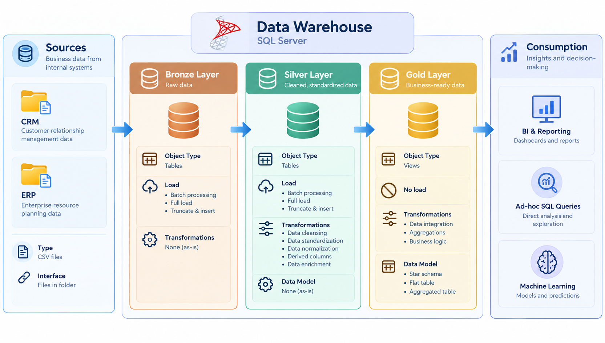

# Data Warehouse and Analytics Project 🚀

## 📌 About the Project

This repository documents my hands-on learning journey in Data Engineering through the development of a modern data warehouse using SQL Server.

Following a structured, step-by-step learning process, I am exploring how to build ETL pipelines, organize data using the Medallion Architecture, and design analytical data models to support business reporting.

My goal is to strengthen my SQL and Data Engineering skills by applying concepts such as data ingestion, data cleaning, data transformation, data modeling, and data quality.

## 🏗️ Data Architecture

The project follows the Medallion Architecture, organized into three layers: Bronze, Silver, and Gold.



- **Bronze Layer:** Ingests raw CSV data from ERP and CRM source systems into SQL Server.
- **Silver Layer:** Cleans, standardizes, and integrates data to improve consistency and quality.
- **Gold Layer:** Organizes business-ready data into fact and dimension tables using a star schema, making it suitable for analytical queries and reporting.

## 🎯 Project Objectives

Through this project, I aim to develop practical skills in:

- **Data Ingestion:** Loading data from multiple source systems.
- **ETL Pipelines:** Extracting, transforming, and loading data using SQL.
- **Data Quality:** Identifying and handling inconsistencies in source data.
- **Data Modeling:** Designing fact tables, dimension tables, and a star schema.
- **SQL Analytics:** Analyzing customer behavior, product performance, and sales trends.
- **Documentation & Version Control:** Documenting the architecture and managing SQL scripts with Git and GitHub.

## 🛠️ Tools & Technologies

- Microsoft SQL Server Express
- SQL Server Management Studio (SSMS)
- SQL
- Draw.io
- Git & GitHub

## 📂 Repository Structure

```text
data-warehouse-project/
├── datasets/       # Source CSV files (ERP and CRM)
├── docs/           # Architecture, data models and documentation
├── scripts/
│   ├── bronze/     # Data ingestion
│   ├── silver/     # Data cleaning and transformation
│   └── gold/       # Analytical data models
├── tests/          # Data quality checks
├── README.md
├── LICENSE
└── .gitignore
```

## 📈 Learning Outcomes

This project is helping me understand the complete data warehousing workflow, from raw data ingestion to analytical data modeling.

I am using this hands-on experience to strengthen my foundations in SQL, ETL development, data quality, and dimensional modeling as I work toward my goal of becoming a Data Engineer.

---
